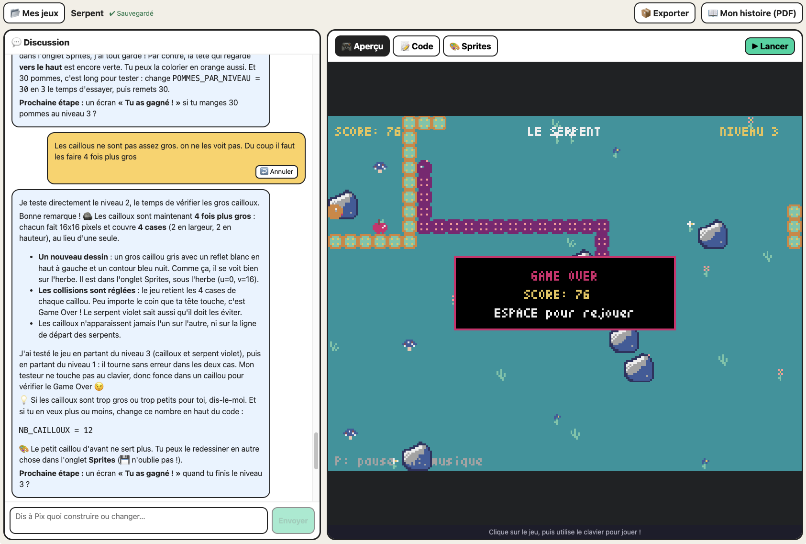

# Pyxel AI Playground

English | [Français](README.fr.md)

Kids build retro games by chatting with Pix, an AI tutor that plans, codes, tests and explains every change in plain language.

[](LICENSE)
[](https://github.com/dmetzler/pyxel-ai-playground/actions/workflows/ci.yml)



*A student building "Le Serpent" (the UI is shown in French here). Chat with Pix on the left, the running game on the right, and the export and PDF story buttons in the top bar.*

## Why

Software isn't written the way it was ten years ago. Today a lot of it is built *with* an AI agent: you describe what you want, the agent makes a plan, edits the code, runs it, fixes what breaks and tells you what it did. Pyxel AI Playground is a tool for teachers who want to show students, from middle school (around age 11) up, what that looks like in practice.

The student never faces a blank editor. They type "I want a maze game" and Pix gets to work: it reads the code, changes it, tests the game, and explains each change in a few kid-friendly sentences. The game runs live next to the chat.

The student stays in control the whole time. They can read and edit the code themselves, undo any step, and draw their own sprites. The point isn't to hide the code behind magic. It's to show that an agent is a collaborator you direct, check and correct.

It's built for classrooms and workshops. A typical session: each student opens the app, creates a game and describes an idea. They playtest, ask for changes, break something, undo it, draw a sprite, and keep going. At the end they download "My story", a PDF booklet of how their game was made, and take it home with the game itself.

Games are made with [Pyxel](https://github.com/kitao/pyxel), a small Python retro game engine (16 colors, pixel art, chiptune sound), so everything a student makes is plain Python they can keep running on their own computer.

## Features

**Headline features**

- **Several games per student.** The start screen lists every game, lets you create a new one, reopen an old one, delete one (with a confirmation, and not while Pix is working on it) or import one. The open game is in the URL (`/snake/`), so refreshing or bookmarking lands on it.
- **Every game is a git repository, so any step can be undone.** Before each Pix turn the student's own edits are committed, then Pix's changes. Undo on a student message puts the code, the sprites and Pix's memory back to the version just before it and removes the rest of the chat. Undo is itself a new commit, so nothing is ever lost: `git log` in the game folder shows everything.
- **Export and import as a zip.** Export downloads the whole game folder (code, sprites, chat, Pix's memory and git history). Import turns such a zip into a new game and never overwrites an existing one. A plain folder with a `game.py` works too. Imported zips are checked (no paths outside the folder, no links, size limits) and their git hooks and config are dropped.
- **"My story" PDF.** A booklet the student takes home, generated with WeasyPrint: a cover with a screenshot of the app and of the finished game, one page per student message (what they asked, Pix's explanation, a screenshot of the game after that step, and the code lines that step added or changed, highlighted in green), the full final code, and how to install Pyxel and keep going at home. Each screenshot comes from running that commit's `game.py` headless for 30 frames.
- **French, English and Polish (fr / en / pl).** The UI, the tutor and the PDF all follow the language. A language selector sits on the start screen and in the top bar of an open game. A new game takes the UI language, and an existing game keeps its own language, so Pix, the commit messages and the PDF stay consistent for that game. The tutor prompts live in `backend/prompt_fr.md`, `prompt_en.md` and `prompt_pl.md`.

**And also**

- **Live preview.** Real Pyxel runs in the browser through Pyodide and the Pyxel wheel, inside a sandboxed iframe. No install for students.
- **Code tab with a change gutter.** A thin colored gutter marks the lines added (green), modified (yellow) or deleted (red) by the last commit, so the student sees what Pix just did. The code is editable. What's on screen is saved to `game.py` before each message, and Pix is told to read it first.
- **Sprite and sound editor.** The Sprites tab embeds Pyxel's official resource editor (images, tilemaps, sounds, music). Its save button writes `res.pyxres` into the game folder, and the preview loads it, so the game can use `pyxel.load("res.pyxres")` and `pyxel.blt(...)`. A reload button brings the saved file back into the editor and the preview.
- **Pix draws sprites and tests games.** Pix reads the current resources, so the student's own drawings are kept. It can draw sprites pixel by pixel, lay out tilemaps and write sounds and music by running a small Python script with headless Pyxel on the server (20 second limit, run on a copy so a failing script leaves the file untouched and Pix gets the error to fix). It also runs the game headless for 60 frames to catch crashes before the student sees them.
- **Stop button.** The student can interrupt Pix mid-turn. What it already did is kept and committed.

## How it works

```
┌──────────────────┬────────────────────────────────────┐
│  Chat with Pix   │  Preview | Code | Sprites          │
│                  │  (live game, code, Pyxel editor)   │
└──────────────────┴────────────────────────────────────┘
```

- **Frontend** (`frontend/`): Vite, React and TypeScript. Chat on the left, tabs on the right. Pyxel runs in the browser with Pyodide.
- **Backend** (`backend/`): FastAPI. Pix is a [Strands harness](https://strandsagents.com/docs/user-guide/harness/) agent (`backend/pix_agent.py`) whose model is any OpenAI-compatible endpoint, typically [LiteLLM](https://github.com/BerriAI/litellm) in front of Anthropic models. The API key stays on the server and never reaches the browser.
- **Edit model**: Pix works like a coding agent, with tools, directly on the game folder: `read`, `write` and `edit` for `game.py` (built into the harness), plus our own `view_resources`, `edit_resources` and `test_game` for sprites, sounds and test runs. In one turn it can read the code, change it, test it and fix it, then write a short explanation. When the turn ends, the backend sends the new `game.py` and `res.pyxres` to the UI, which updates the editor and reloads the preview.
- **Sandboxed tools**: the file tools are locked to the game's folder (`GameFolderSandbox`) and there is no shell.
- **Storage**: each game is a folder in `games/<name>/` and its own git repository. It holds `game.py` (also runnable with desktop Pyxel: `pyxel run games/<name>/game.py`), `chat.json`, `meta.json` (including the game's language), `res.pyxres` once sprites exist, and `.pix/`, where the harness saves Pix's conversation so it picks up where it left off after a restart. `chat.json` isn't versioned, Pix's memory is.

## Quick start with Docker

```bash
cp backend/.env.example backend/.env   # fill in LITELLM_API_KEY and LITELLM_MODEL
docker compose up -d --build
```

Then open http://localhost:8080. Change the port with `PORT=9000 docker compose up -d`.

- `frontend` is the built app served by nginx, which proxies `/api` to `backend` without buffering the streamed replies.
- `backend` is FastAPI plus headless Pyxel. Games are stored in `./games` on your disk, mounted as a volume.
- The LLM endpoint is expected on the host machine. By default the backend calls `http://host.docker.internal:4001`. If your endpoint runs elsewhere, set `LITELLM_BASE_URL` in your shell or in a `.env` file next to `docker-compose.yml`, for example `LITELLM_BASE_URL=http://host.docker.internal:4000`. The `localhost` value in `backend/.env` is ignored by Docker, because inside the container `localhost` is the container itself.

Backend settings (`backend/.env`):

| Variable | Purpose | Default |
|---|---|---|
| `LITELLM_BASE_URL` | OpenAI-compatible endpoint | `http://localhost:4000` |
| `LITELLM_API_KEY` | API key for that endpoint | none (required) |
| `LITELLM_MODEL` | Model name the endpoint maps to | `claude-3-5-sonnet` |
| `PIX_MAX_TOKENS` | Max tokens per tutor reply | `16000` |
| `GAMES_DIR` | Where games are stored | `backend/../games` (`/games` in Docker) |

## Deploy on Kubernetes (Helm)

The chart in `charts/pyxel-ai-playground` deploys the whole app for a school or a workshop series. See also the [chart README](charts/pyxel-ai-playground/README.md).

```
Ingress -> Service -> frontend pod
             [oauth2-proxy sidecar :4180] -> [nginx :80: app + /api proxy] -> backend Service :8000
```

**Why oauth2-proxy?** The app has no accounts of its own, and it spends LLM credits. The chart puts an [oauth2-proxy](https://oauth2-proxy.github.io/oauth2-proxy/) sidecar in front of nginx, so nobody reaches the app without signing in through your identity provider (Keycloak, Google, any OIDC provider). You can restrict access to some e-mail domains (`oauth2Proxy.emailDomains`) or to members of some groups (`oauth2Proxy.allowedGroups`). For local tests only, `auth.enabled=false` drops the sidecar, and the app is then open to anyone who can reach it.

The backend keeps games on a `ReadWriteOnce` volume (`persistence.size`, 5Gi by default), so it always runs a single replica.

```bash
helm install pyxel charts/pyxel-ai-playground -n pyxel --create-namespace \
  --set oauth2Proxy.issuerUrl=https://keycloak.example.com/realms/school \
  --set oauth2Proxy.clientId=pyxel \
  --set oauth2Proxy.clientSecret=<client-secret> \
  --set oauth2Proxy.cookieSecret=$(openssl rand -base64 32 | tr -- '+/' '-_' | head -c 32) \
  --set openai.baseUrl=http://litellm:4000 \
  --set openai.apiKey=<llm-api-key> \
  --set ingress.enabled=true \
  --set ingress.host=pyxel.example.com
```

Useful values:

| Value | Purpose |
|---|---|
| `openai.baseUrl`, `openai.apiKey`, `openai.model` | The LLM endpoint Pix talks to. |
| `openai.existingSecret` | Use an existing Secret (key `api-key`) instead of putting the key in the chart. |
| `oauth2Proxy.issuerUrl`, `clientId`, `clientSecret`, `cookieSecret` | Your identity provider and the proxy's secrets. |
| `oauth2Proxy.existingSecret` | Existing Secret with keys `client-id`, `client-secret`, `cookie-secret`. |
| `oauth2Proxy.emailDomains`, `oauth2Proxy.allowedGroups` | Who may sign in. |
| `persistence.size`, `persistence.storageClass`, `persistence.existingClaim` | Where games are stored. |
| `ingress.enabled`, `ingress.className`, `ingress.host`, `ingress.tls` | How the app is exposed. |
| `auth.enabled` | `false` removes oauth2-proxy (local tests only). |

The images are published to `ghcr.io/dmetzler/pyxel-ai-playground-backend` and `ghcr.io/dmetzler/pyxel-ai-playground-frontend` for `linux/amd64` and `linux/arm64`.

## Development

Run the backend and the frontend separately, with hot reload.

**Backend**

```bash
cd backend
python3 -m venv .venv && source .venv/bin/activate
pip install -r requirements.txt
cp .env.example .env   # then fill in LITELLM_BASE_URL, LITELLM_API_KEY, LITELLM_MODEL
uvicorn app:app --reload --port 8000
```

The PDF story needs Pango on the machine (for WeasyPrint): `brew install pango` on macOS, `apt install libpango-1.0-0 libpangoft2-1.0-0` on Debian or Ubuntu.

**Frontend**

```bash
cd frontend
npm install
npm run dev        # http://localhost:5173, proxies /api to :8000
```

Open the browser, tell Pix "I want to make a maze game", and go.

**Adding a language.** Add it to the dictionaries in `frontend/src/i18n.ts` (TypeScript lists any missing key), to `frontend/src/starter.ts` (starter code must be ASCII, because `pyxel.text` can't draw other characters), then add `backend/prompt_<lang>.md` and the backend strings in `backend/i18n.py`, and allow the code in the API.

## Tests

```bash
cd backend && pip install -r requirements-dev.txt && python -m pytest -q
cd frontend && npm test
```

- **Backend** (`backend/tests/`): runs the real FastAPI app, Strands harness, git and headless Pyxel, with a scripted model in place of the LLM (no network, no API key). Covers saving and loading games, the chat stream and its commits, the folder sandbox, stop, undo, delete, export and import (including unsafe zips), the PDF story in each language, and `res_tool.py`.
- **Frontend** (`frontend/src/*.test.ts`, Vitest): the change-gutter diff, the chat text cleanup, the SSE stream parser, the API calls, and the translation dictionaries.
- **CI** (`.github/workflows/ci.yml`) runs both suites and `helm lint` on every pull request and push to main.

## Project layout

```
backend/
  app.py          API: games on disk, git history, chat stream (SSE), stop, undo, delete, export/import
  pix_agent.py    the Pix agent: Strands harness, sandbox, resource and test tools
  res_tool.py     headless Pyxel: draw into res.pyxres, describe it, test-run or screenshot a game
  story.py        the PDF story of a game (WeasyPrint)
  i18n.py         backend strings and language handling (fr, en, pl)
  assets/         the app screenshot used on the PDF cover
  prompt_*.md     the tutor prompt, one per language
  tests/          pytest suite
frontend/src/
  App.tsx         game picker, URL routing, chat turn, undo, export and PDF buttons
  GamePicker.tsx  start screen: create, open, delete, import
  ChatPane.tsx    the chat (stop and undo buttons)
  RightPane.tsx   Preview, Code and Sprites tabs
  changeGutter.ts the "what changed" gutter in the code editor
  pyxelFrame.ts   in-browser Pyxel (Pyodide) for the preview and the resource editor
  i18n.ts         UI dictionaries (fr, en, pl)
  api.ts          backend calls and the SSE parser
charts/           Helm chart
docs/images/      README screenshot
games/            one folder (and git repo) per game, not versioned here
```

## License

[Apache License 2.0](LICENSE)
